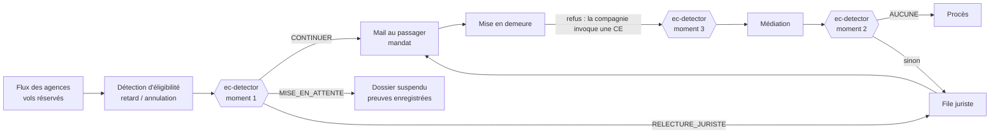
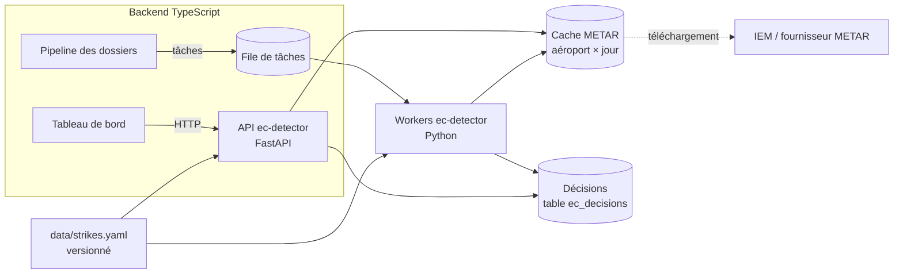

# Intégration dans le produit

Comment le module s'insère dans le traitement d'un dossier, techniquement et côté produit.
Ce qui existe déjà dans le repo est signalé ✅ ; ce qui est proposé, 🔜.

---

## 1. Où le module intervient



| Moment | Question posée au module | Effet d'une erreur |
|---|---|---|
| **1. Avant le mail au passager** (principal) | Le dossier est-il perdu d'avance ? | Mail envoyé à tort au client de l'agence, ou bon dossier abandonné |
| **2. Avant d'engager un procès** | Une CE probable fragilise-t-elle le dossier ? | Procès perdu, risque déontologique |
| **3. Quand la compagnie invoque une CE** | Est-ce crédible ? Quelles preuves contraires ? | Mauvaise réponse à la compagnie |

Au moment 3, le module ne connaît pas le motif invoqué par la compagnie (H5). Le produit compare lui-même : la compagnie invoque la météo, mais le module dit `AUCUNE` avec des METAR calmes → argument contraire, avec les relevés bruts en pièce. C'est le cas d'usage où le module apporte le plus aux juristes, sans rien automatiser.

---

## 2. Ce que le produit fait de chaque action

| Action | Produit | Humain |
|---|---|---|
| `CONTINUER` | Le dossier avance (mail, puis mise en demeure) | Aucun |
| `MISE_EN_ATTENTE` | Pas de mail. Dossier suspendu avec la décision et ses preuves | Aucun ; relecture possible par échantillon (§7) |
| `RELECTURE_JURISTE` | Tâche dans la file juriste, avec les raisons et les preuves déjà rassemblées | Un juriste tranche, sa décision est enregistrée à côté de celle du module |

Le module **propose** une action, le produit **décide** de l'appliquer. Chaque action peut être activée ou non, par type de CE (voir le déploiement progressif, §8). Exemple : appliquer `CONTINUER` automatiquement, mais envoyer encore les `MISE_EN_ATTENTE` « grève » en relecture tant que l'imputation à la journée (D12) n'est pas validée par les juristes.

---

## 3. Architecture

Le backend est en TypeScript / Node. Le module reste un **service Python séparé**, sans état, appelé de deux façons.



- **Traitement par lots** 🔜 : le pipeline dépose les dossiers éligibles dans une file (par exemple Redis/BullMQ, déjà courant côté Node, ou SQS). Des workers Python appellent `decide()` et écrivent le résultat. C'est le chemin du moment 1, sur tout le flux.
- **Appel à la demande** ✅ : `POST /api/decide` et `POST /api/decide/batch` (`src/ec_detector/api.py`) pour les moments 2 et 3, et pour un juriste qui relance un dossier depuis le tableau de bord. Documentation OpenAPI sur `/docs` : le client TypeScript peut en être généré.
- **Même code, même JSON** ✅ : la CLI, l'API et le worker appellent la même fonction `decide()` et renvoient `Decision.to_dict()`.

### Pourquoi un service séparé, et pas une réécriture en TypeScript

- Le cœur est petit (règles + lecture METAR) et déjà testé ; le réécrire doublerait le risque d'écart.
- Les règles et le calendrier changent au rythme des juristes, pas du produit : un service versionné à part se déploie seul.
- Coût : un appel HTTP ou une file de plus. Acceptable, la décision n'est pas sur un chemin temps réel.

---

## 4. Contrat d'interface

Entrée : uniquement les aéroports et les horaires. **Aucune donnée personnelle** n'est envoyée au service (ni nom, ni réservation) : il ne voit qu'un identifiant de dossier, deux codes OACI et quatre heures UTC.

```ts
// Type côté backend, généré depuis /openapi.json ou écrit à la main.
type Action = "CONTINUER" | "MISE_EN_ATTENTE" | "RELECTURE_JURISTE";
type Status = "EC_PROBABLE" | "AUCUNE" | "INCERTAIN";

interface EcDecision {
  case_id: string;
  status: Status;
  action: Action;
  ec_type: "METEO" | "GREVE_ATC" | null;
  ec_types: string[];
  confidence: number;               // niveau fixé par règle, pas une probabilité (D11)
  delay_total_minutes: number;
  delay_explained_minutes: number;  // estimation
  remaining_delay_minutes: number;
  fully_explained: boolean;
  reasons: string[];
  explanation: string;
  evidence: object[];               // METAR bruts, grèves et leurs sources
  legal_regime: "CE_261_2004" | "UE_2026_2202";
  rules_version: string;
  strike_calendar_version: string | null;
  computed_at: string;              // ISO 8601
}
```

Règles du contrat :
- **Heures en UTC, avec fuseau.** Une heure sans fuseau est refusée (422 avec message) ✅. La conversion depuis l'heure locale de l'agence se fait côté backend, une seule fois.
- **Idempotence** : même `case_id`, mêmes horaires, mêmes versions → même décision. Le backend peut relancer sans risque.
- **Erreurs** : une source indisponible ne produit jamais d'erreur HTTP ni `AUCUNE`, mais `INCERTAIN` avec la raison (D9) ✅. Les erreurs HTTP sont réservées aux entrées invalides.

---

## 5. Stockage sur le dossier

Une table `ec_decisions` 🔜, **en ajout seul** : on n'écrase jamais une décision, on en ajoute une nouvelle.

| Colonne | Rôle |
|---|---|
| `case_id`, `moment` (1, 2 ou 3) | Lien au dossier et à l'étape |
| `status`, `action`, `ec_types`, `confidence` | Pour filtrer et compter |
| `delay_explained_minutes`, `remaining_delay_minutes` | Pour le juriste |
| `rules_version`, `strike_calendar_version`, `legal_regime` | Traçabilité |
| `computed_at` | Date du calcul |
| `payload` (JSON) | La décision complète, preuves comprises |
| `reviewed_by`, `review_status`, `review_comment` | Décision du juriste, quand il y en a une |

Pourquoi en ajout seul : en médiation ou en procès, il faut pouvoir montrer **ce que le module savait, avec quelles règles, à quelle date**. Une nouvelle version des règles ne réécrit pas le passé ; au moment 2, on relance avec les règles du jour et on garde les deux décisions.

---

## 6. Volume et cache

- Les décisions d'un lot portent sur peu d'aéroports et de jours : les vols d'une journée au départ de Roissy partagent les mêmes relevés. Le coût réel est donc le nombre de couples **(aéroport, jour)**, pas le nombre de dossiers.
- ✅ Le prototype met en cache une journée METAR par aéroport (`data/cache/metar/<OACI>/<jour>.csv`), et respecte la source (pause entre requêtes, réessais, `Retry-After`).
- 🔜 En production : cache partagé entre workers (stockage objet ou base), et pré-chargement des couples (aéroport, jour) d'un lot avant de lancer les décisions. Les jours passés ne changent plus : le cache n'expire pas.
- 🔜 Source METAR : l'IEM convient au prototype. Pour la production, un fournisseur avec engagement de service, derrière la même interface `get_observations` (D3).

---

## 7. Indicateurs et pilotage

Les deux indicateurs du produit, déjà calculés sur les dossiers de démonstration ✅ (`scripts/evaluate.py`, onglet Évaluation) :

1. **Part traitée sans humain** : `CONTINUER` + `MISE_EN_ATTENTE` sur le total.
2. **Taux d'erreur parmi les décisions automatiques**, avec les erreurs critiques à part (`CONTINUER` alors qu'une CE était plausible).

En production, le second ne se mesure pas tout seul : une décision automatique n'est relue par personne. Proposition 🔜 :
- **Audit par échantillon** : chaque semaine, un juriste relit un petit échantillon tiré au hasard parmi les `CONTINUER` et les `MISE_EN_ATTENTE`. Le taux d'erreur est mesuré sur cet échantillon.
- **Retour terrain** : l'issue des médiations et des procès (CE invoquée par la compagnie, retenue ou non par le juge) est rattachée à la décision du module. C'est la base pour **calibrer** les seuils et la confiance (D1, D11), sans les remplacer par un modèle.
- **Par version** : les indicateurs sont suivis par `rules_version`. Un changement de seuil se valide en rejouant l'historique annoté avant de le déployer.
- **Alertes** : part d'`INCERTAIN` en hausse brutale (source METAR en panne, calendrier non couvert), part de `CONTINUER` en hausse un jour de grève connue.

---

## 8. Déploiement progressif

| Phase | Ce que fait le module | Condition pour passer à la suivante |
|---|---|---|
| **0. Observation** | Tourne sur tout le flux, ne déclenche rien. Les décisions sont comparées à celles des juristes | Écart mesuré et accepté par les juristes |
| **1. Aide** | Décision et preuves affichées dans le tableau de bord ; le juriste tranche plus vite | Seuils et imputation des grèves validés (H2, D12) |
| **2. Automatique, prudent** | `CONTINUER` appliqué automatiquement ; `MISE_EN_ATTENTE` encore relu | Taux d'erreur de l'audit sous un seuil fixé avec les juristes |
| **3. Automatique** | `MISE_EN_ATTENTE` appliqué aussi, type de CE par type de CE | Suivi continu (§7) |

La phase 0 ne coûte rien côté produit et donne la première vraie mesure, sur de vrais dossiers.

---

## 9. Maintenance des données

- **Seuils** (`config/rules.yaml`) : modifiés avec les juristes, nouvelle version à chaque changement, rejeu de l'historique avant déploiement.
- **Calendrier des grèves** (`data/strikes.yaml`) 🔜 : revue mensuelle. Un LLM peut lire la presse et les avis DGAC et **proposer** des entrées (dates, aéroports, sources) ; un humain valide avant d'ajouter (D2, D12). La couverture (`coverage`) n'est étendue que pour les périodes réellement vérifiées : c'est elle qui autorise `CONTINUER`.
- **Réforme (UE) 2026/2202** : les vols à partir du 23 octobre 2027 sortent en `INCERTAIN` tant que le nouveau jeu de règles n'est pas écrit (D10). Le moteur choisit déjà le régime selon la date du vol ✅.

---

## 10. Ce que d'autres données apporteraient

| Donnée | Ce qu'elle débloque |
|---|---|
| **Numéro de vol et immatriculation** | Suivre le vol précédent du même avion (CJUE C-74/19) ; aujourd'hui hors périmètre |
| **Motif donné par la compagnie** | Comparer directement motif invoqué et signaux observés (moment 3) |
| **Flux de vols déjà reçus des agences** | Le signal « perturbation générale » (H9) : beaucoup de vols retardés au même aéroport, toutes compagnies |
| **Retards Eurocontrol par aéroport et par cause** | Une évaluation chiffrée sur de vraies journées (D4), au lieu de 13 dossiers construits |
| **Historique de dossiers et de leur issue** | Calibrer seuils et confiance |
